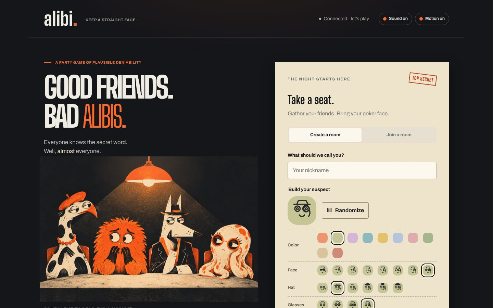
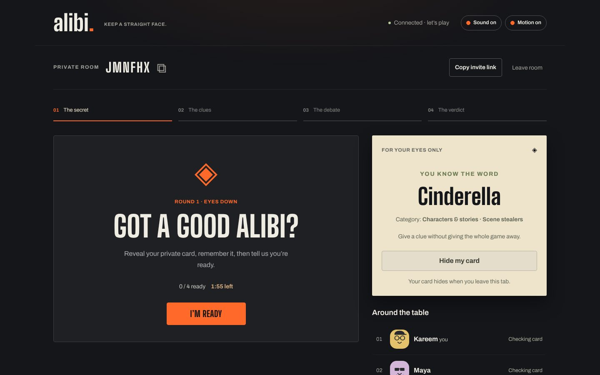

# Alibi

A real-time party game for 4 to 10 friends on a voice call. Everyone gets a secret word except one player, the imposter, who only knows the category. Take turns giving clues, argue about who's bluffing, then vote.



## How a round works

1. The host picks categories and starts. The server deals one secret word, one imposter and a random speaking order.
2. Everyone reveals their card privately and marks themselves ready.
3. Players give one clue each, out loud, then the group discusses.
4. Everyone votes in secret. Votes appear together when the ballot closes, and ties go to one runoff.
5. If the group catches the imposter, the imposter gets one guess at the word to steal the win.



## Built with

- **Node.js, Express 5 and Socket.IO** on one server that owns every rule, timer and outcome
- **Vanilla JavaScript, CSS and GSAP** in the browser, with an SVG avatar builder and synthesized Web Audio sound
- **Node test runner and Playwright** for 46 engine and socket tests plus a four-player browser run

## Things I'm proud of

- **No cheating through devtools.** Each player gets a snapshot built just for them. The imposter never receives the word, hosts never see other roles, and open ballots only show how many people have voted.
- **Reconnects that keep your seat.** Refreshing or switching back from another app restores your player through an HttpOnly session cookie. A dropped player has two minutes to come back, and the host role passes on automatically if the host leaves.
- **Safe retries.** Every action carries an ID, so a double tap or a replayed request from an old tab does nothing.
- **Basic abuse limits.** Same-origin checks on sockets, per-player action limits and per-address session limits that work behind a proxy.

## Run it

```sh
npm install
npm start
```

Open http://localhost:3000, create a room and share the invite link. Each player needs their own browser session, so use different browsers or profiles to test alone.

```sh
npm test              # engine and socket tests
npm run test:browser  # four-player Chrome run
```

## Hosting

Rooms live in memory, so Alibi runs as a single long-running Node process with WebSocket support. `render.yaml` sets up one Render web service. In production, set `NODE_ENV=production` and `PUBLIC_ORIGIN` to the site's HTTPS address.

The interrogation-table illustration is generated artwork; the avatars and interface are original.
